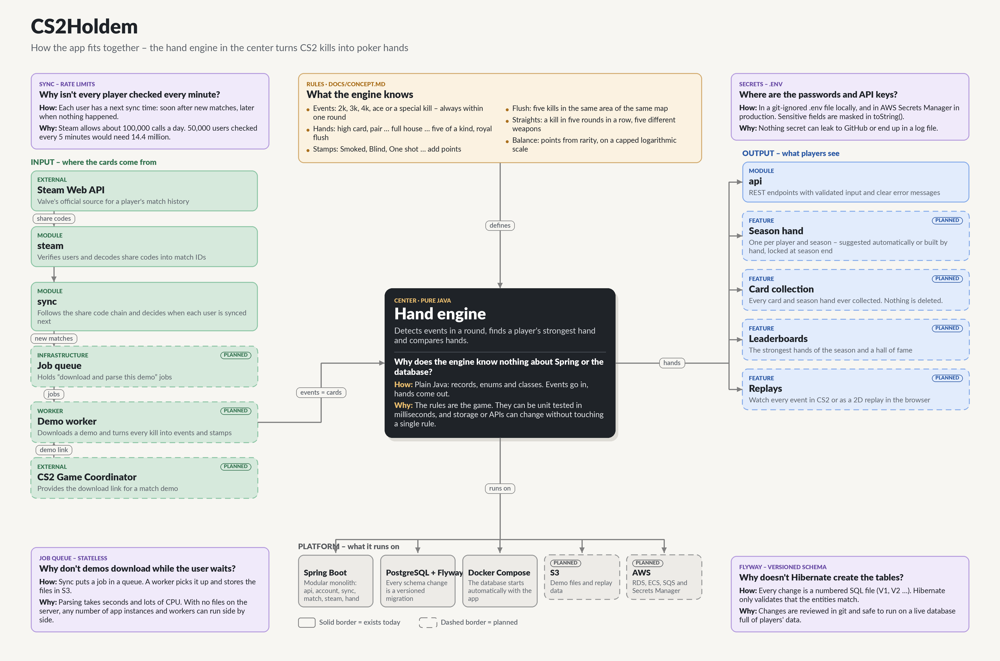

# CS2Holdem


**Collect the best moments of your CS2 season and play them as a poker hand.**

CS2Holdem turns your Counter-Strike 2 highlights into playing cards. Every double kill,
triple kill, ace or knife kill you make during a season becomes a card in your collection.
From those cards you build the strongest poker hand you can: a triple kill and a double kill
make a **full house**, an ace makes **five of a kind**, and a perfect ace is a **royal flush**. Stamps such as *Smoked* or *One shot*
show how spectacular each moment was, and when the CS2 season ends, the strongest hand wins.

Players connect their Steam account once. From then on CS2Holdem discovers every new match
they play, downloads the demo and finds the highlight moments in it.

The project is built as a production-style backend from day one: versioned database
migrations, a clean module structure, secrets kept out of the code, and an architecture that
can grow from one user to thousands without being rewritten.

---

## Contents

- [How it works](#how-it-works)
- [Features](#features)
- [Tech stack](#tech-stack)
- [Architecture](#architecture)
- [Engineering decisions](#engineering-decisions)
- [Data model](#data-model)
- [API](#api)
- [Getting started](#getting-started)
- [Project structure](#project-structure)
- [Roadmap](#roadmap)
- [About the author](#about-the-author)

---

## How it works

| Poker      | CS2Holdem                                                              |
|------------|------------------------------------------------------------------------|
| Card       | A highlight event from one round: double kill, triple kill, ace, ...   |
| Hand       | Up to five kills' worth of events from the same season                 |
| Hand type  | Every poker hand has an equivalent: high card (a knife kill), pair (2k), two pair, three of a kind (3k), straight (a kill in 5 rounds in a row with 5 different weapon groups), flush (5 kills in the same area of the same map), full house (3k + 2k), four of a kind (4k), straight flush, five of a kind (ace) and royal flush (a perfect ace) |
| Stamps     | Extra points per kill or event: the enemy was *Flashed*, *Smoked* or *Burning*, you were *Blind* or *On fire*, *Headshot*, *Wallbang*, *One grenade*, *One shot*, ... |
| Score      | One total score per hand: base points for the hand type + kill points (damage x weapon difficulty) + stamp points. A spectacular three of a kind can beat a dull full house |
| Game       | One CS2 season. Each player has one season hand; the strongest one wins |

**Example:** a round where one HE grenade kills three (*One grenade*) and another round where
one AWP shot kills two (*One shot*) together make an exceptionally strong **full house**.

The app always suggests the strongest possible hand, but players can build their own.
Every season hand and every card is kept permanently on the player's profile, and every
event can be replayed so you can watch exactly how it happened.

The full rules are in **[docs/CONCEPT.md](docs/CONCEPT.md)**.

## Features

**Working today**

- Register with a SteamID64, a CS2 match-history auth code and one known share code
- Credentials are verified against the Steam Web API before an account is created
- Full match history is discovered by following Valve's chain of share codes
- Share codes are decoded into match ID, reservation ID and TV port
- Manual re-sync and a match list per user through a REST API
- Consistent error responses following RFC 9457 (Problem Details), including per-field validation errors

**Planned**

- Demo download through the CS2 Game Coordinator
- Demo parsing into individual kills: weapon, damage, round and circumstances
- Event detection: double kills, triple kills, aces and special kills per round
- Stamps such as *Smoked*, *Wallbang*, *One grenade* and *One shot*
- Hand evaluation engine that finds and compares the strongest hands
- Seasons, season hands, leaderboards and a permanent card collection
- Watch every event: a "watch in CS2" button and a 2D replay in the browser
- Encrypted storage of users' auth codes
- Scheduled background sync that respects Steam's API rate limits
- Deployment on AWS

## Tech stack

| Area          | Choice                                                  |
|---------------|---------------------------------------------------------|
| Language      | Java 21                                                 |
| Framework     | Spring Boot 4 (Web MVC, Data JPA, Validation, RestClient) |
| Build         | Maven                                                   |
| Database      | PostgreSQL 16, schema managed by Flyway                 |
| ORM           | Hibernate 7 (schema validation only)                    |
| Local env     | Docker Compose, started automatically by Spring Boot    |
| Testing       | JUnit 5, AssertJ                                        |
| Cloud (planned) | AWS: RDS, S3, SQS, ECS, Secrets Manager               |

## Architecture

At the centre of CS2Holdem is the **hand engine**: the rules that turn kills into poker hands.
Everything else exists either to **feed** it with cards, to **show** what it produces, or to
**run** it.



A Swedish version is available in [docs/architecture-sv.png](docs/architecture-sv.png).

### What each part does, and why

**The centre**

| Part | What it does | Why | Status |
|------|--------------|-----|--------|
| **Hand engine** | Detects events in a round, finds a player's strongest hand and compares hands. | It *is* the game. Written in pure Java with no framework or database, so the rules can be unit tested in isolation and never depend on how data is stored. | Next up |

**Rules** – what the engine knows. Full details in [docs/CONCEPT.md](docs/CONCEPT.md).

| Part | What it does | Why |
|------|--------------|-----|
| Events | A double kill, triple kill, quad kill, ace or special kill within one round becomes a card. | Only real highlight moments count, so a collection stays worth looking at. |
| Hands | Up to five kills' worth of events form a hand, from high card to royal flush. | Familiar poker logic makes the game easy to understand. |
| Stamps | Circumstances such as *Smoked*, *Blind* or *One shot* add points. | Two full houses are not equal; stamps reward the spectacular. |
| Flushes | Five kills in the same area of the same map. | Ties hands to real places, e.g. five kills in Mid on de_mirage. |
| Straights | A kill in five rounds in a row, with five different weapon groups. | A series like a poker straight, and an active choice: you have to buy different weapons on purpose. |
| Balance | Points are derived from how rare something is, on a capped logarithmic scale. | Keeps any single stamp or weapon from dominating, even if players farm it. |

**Input** – where the cards come from.

| Part | What it does | Why | Status |
|------|--------------|-----|--------|
| `steam` module + Steam Web API | Verifies users and follows the chain of share codes to discover new matches. | Valve's only official way to learn which matches a player has played. | Done |
| `sync` module | Decides when each user is synced next and records new matches. | Spreads calls over time to stay within Steam's daily API limit. | Done |
| CS2 Game Coordinator | Provides the download link for a match's demo file. | Kill-by-kill data only exists in the demo; the Web API has no such details. | Planned |
| Job queue | Holds "download and parse this demo" jobs. | Parsing a demo takes seconds and lots of CPU; users should never wait for it. | Planned |
| Demo worker | Downloads a demo, extracts every kill and detects events and stamps. | Turns hundreds of megabytes of raw data into a handful of cards. | Planned |

**Output** – what players see.

| Part | What it does | Why | Status |
|------|--------------|-----|--------|
| `api` module | REST endpoints with validated input and Problem Details errors. | One clear entry point for any client: web, mobile or tools. | Done |
| Season hand | One hand per player and season, suggested automatically or built by hand, locked at season end. | The competitive core: the strongest hand wins the season. | Planned |
| Card collection | Every card and season hand a player has ever collected. | Nothing is deleted, so a profile tells a player's whole story. | Planned |
| Leaderboards | The strongest hands of the season and a hall of fame. | Gives players something to chase and show off. | Planned |
| Replays | A "watch in CS2" button and a 2D replay in the browser. | Seeing a friend's crazy hand is half the fun. | Planned |

**Platform** – what it all runs on.

| Part | What it does | Why | Status |
|------|--------------|-----|--------|
| Spring Boot, modular monolith | One application organised by feature: `api`, `account`, `sync`, `match`, `steam`, `hand`. | Simple to run and develop, while modules depend on each other in one direction only and can be split out later. | Done |
| PostgreSQL + Flyway | Stores players, matches, events and hands; every schema change is a versioned migration. | Reliable relational data, and changes that are safe to apply to a live database. | Done |
| Docker Compose | Starts PostgreSQL locally, automatically, when the app starts. | Anyone can clone and run the project without installing a database. | Done |
| S3 | Stores demo files temporarily and replay data permanently. | Keeps large files out of the database and lets any number of app instances share them. | Planned |
| AWS | RDS, ECS, SQS and Secrets Manager. | Scales from one user to thousands without changing the code. | Planned |

## Engineering decisions

A few choices worth calling out, and the reasoning behind them:

- **Flyway owns the schema, Hibernate only validates it.** Every database change is a
  reviewed SQL file in version control (`V1__...`, `V2__...`). Hibernate runs with
  `ddl-auto: validate`, so the app refuses to start if the Java entities and the database
  ever drift apart.
- **External calls happen outside database transactions.** Registration verifies the user
  with Steam first, then saves the player and account in a single short transaction. A slow
  Steam response never holds a database connection.
- **Concurrency is handled, not hoped for.** When two teammates sync at the same moment and
  both discover the same match, the database's primary key rejects the duplicate and the
  sync carries on.
- **Rate-limit aware scheduling.** Each user gets a `next_sync_at` based on activity: soon
  when more matches are waiting, later when nothing new was found. This is the foundation
  for staying within Steam's daily API quota at scale.
- **64-bit IDs are JSON strings.** SteamIDs and match IDs exceed 2^53, the largest integer
  JavaScript can represent exactly, so the API never sends them as numbers.
- **Secrets never touch the codebase.** Database credentials and the Steam API key live in
  a git-ignored `.env` locally and in environment variables in production. Sensitive values
  are masked in `toString()` so they cannot leak into logs.
- **Entities protect their own rules.** No public setters; state changes go through named
  methods such as `match.markParsed(...)`. JPA's required no-args constructors are
  `protected` so they cannot be misused.
- **One score, many factors.** A hand's score combines hand type, damage, weapon difficulty
  and stamps, and the weights are balanced by how rare things are across all players.
- **Raw numbers are stored, ratios are derived.** Total damage and headshot kills are
  persisted; ADR and HS% are calculated, so averages across many matches stay exact.

## Data model

| Table                | Purpose                                                                 |
|----------------------|-------------------------------------------------------------------------|
| `players`            | Every Steam player seen in any match, registered or not                 |
| `app_users`          | Players who signed up; holds their auth code and sync schedule          |
| `matches`            | One row per match, shared by everyone who played in it                  |
| `match_history`      | Which matches belong to a registered user's history                     |
| `match_player_stats` | One player's performance in one match                                   |

Next up: tables for kills, events (the cards), stamps, seasons and season hands.
See the data model section in [docs/CONCEPT.md](docs/CONCEPT.md#10-what-this-means-for-the-data-model).

## API

| Method | Path                                | Description                                       |
|--------|-------------------------------------|---------------------------------------------------|
| POST   | `/api/accounts`                     | Register and discover match history               |
| POST   | `/api/accounts/{steamId64}/sync`    | Fetch new matches from Steam now                  |
| GET    | `/api/accounts/{steamId64}/matches` | List matches in the user's history, newest first  |

Example:

```http
POST /api/accounts
Content-Type: application/json

{
  "steamId64": "76561197960287930",
  "authCode": "ABCD-EFGHJ-KLMN",
  "knownShareCode": "CSGO-GADqf-jjyJ8-cSP2r-smZRo-TO2xK"
}
```

```json
HTTP/1.1 201 Created

{ "steamId64": "76561197960287930", "matchesFound": 4 }
```

Validation errors explain exactly what is wrong:

```json
HTTP/1.1 400 Bad Request

{
  "title": "Validation failed",
  "status": 400,
  "detail": "One or more fields are invalid.",
  "errors": {
    "authCode": "must look like XXXX-XXXXX-XXXX",
    "steamId64": "must be a 17-digit SteamID64"
  }
}
```

Ready-to-run requests for IntelliJ's HTTP client are in [`http/accounts.http`](http/accounts.http).

## Getting started

**Requirements:** JDK 21 and Docker Desktop.

1. Copy the environment template and fill in your own values:
   ```bash
   cp .env.example .env
   ```
   You need a Steam Web API key from <https://steamcommunity.com/dev/apikey>.
2. Start the application:
   ```bash
   ./mvnw spring-boot:run      # Windows: mvnw.cmd spring-boot:run
   ```
   Spring Boot starts PostgreSQL from `docker-compose.yml`, connects to it automatically,
   and Flyway creates the schema. The API is available on `http://localhost:8080`.
3. To register yourself you need a match-history **auth code**, which you can create on
   [Steam's CS2 match history page](https://help.steampowered.com/en/wizard/HelpWithGameIssue/?appid=730&issueid=128),
   and one **share code** from a recent match, found in-game under *Watch → Your Matches*.

Run the tests (Docker must be running for the integration test):

```bash
./mvnw test
```

## Project structure

```
src/main/java/com/robrodesign/cs2holdem
├── account/   registered users and registration
├── api/       REST controllers, request/response DTOs, global error handling
├── match/     matches, match history and per-player statistics
├── player/    every Steam player seen in a match
├── steam/     Steam Web API client and share code decoding
└── sync/      discovery of new matches

src/main/resources
├── application.yaml
└── db/migration/   Flyway migrations (V1, V2, ...)
```

## Roadmap

- [x] Project foundation: schema, migrations and local environment
- [x] Register users and discover match history via the Steam Web API
- [ ] Encrypt stored auth codes
- [ ] Scheduled sync within Steam's API rate limits
- [ ] Fetch demo URLs from the CS2 Game Coordinator
- [ ] Hand evaluation engine in pure Java (events, hands, comparison)
- [ ] Demo worker: extract every kill from a demo and detect events
- [ ] Stamps
- [ ] Seasons, season hands and leaderboards
- [ ] Event replays: watch in CS2 and 2D replay in the browser
- [ ] CI pipeline with GitHub Actions
- [ ] Deploy to AWS

## About the author

Hi, I'm **Magnus**, a Java developer in training based in Stockholm.

I'm studying **Java Developer with a Cloud Focus** (*Javautvecklare med molninriktning*),
a full-time higher vocational education program covering Java, Spring, databases and
cloud development on AWS.

CS2Holdem started from two things I care about: I play a lot of Counter-Strike 2, and I
wanted a project that goes beyond course assignments. The idea of collecting your highlight
moments and playing them as a poker hand is my own, and building it means solving real backend problems: external APIs,
processing large binary files, data modelling, concurrency, security and scalability. I build it step by step and try to make every decision one I can explain.

Outside of code I'm a hands-on maker: CNC machining, 3D printing and laser engraving.

- GitHub: [@magnushagerstrom](https://github.com/magnushagerstrom)

---

*CS2Holdem is an independent project and is not affiliated with or endorsed by Valve
Corporation. Counter-Strike and Steam are trademarks of Valve Corporation.*
